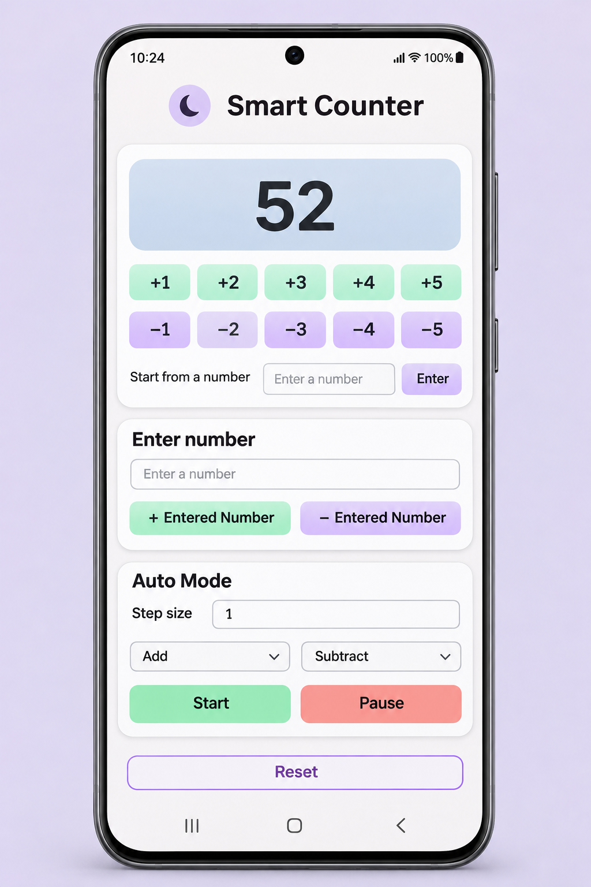
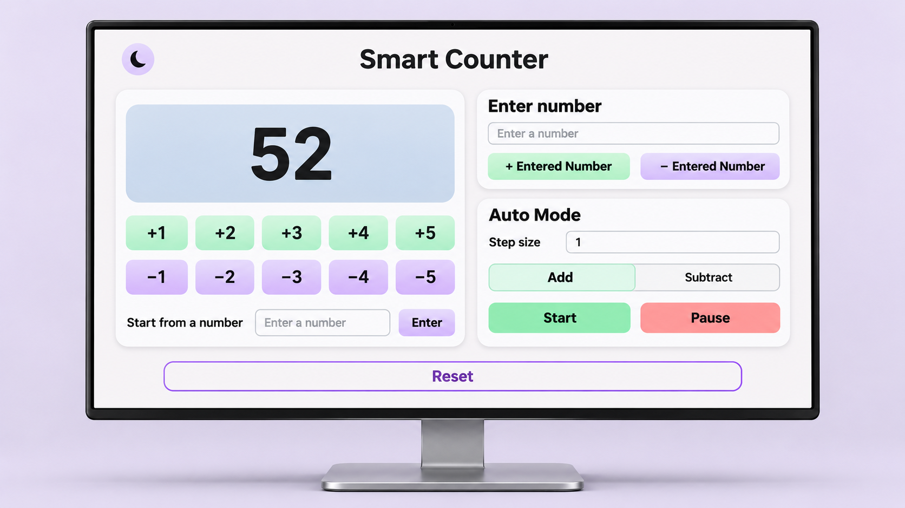
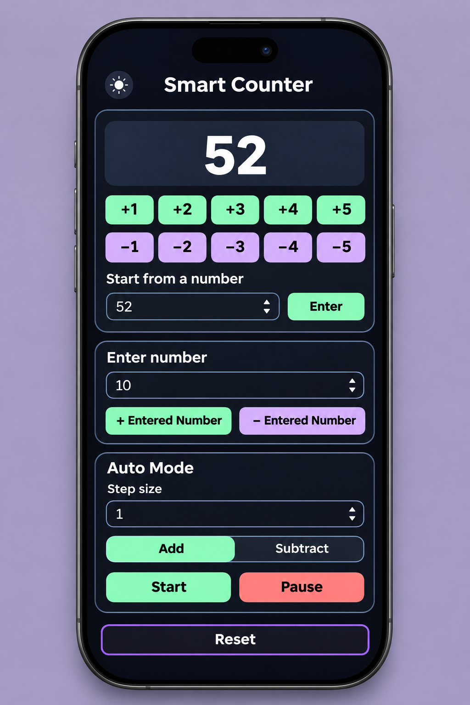
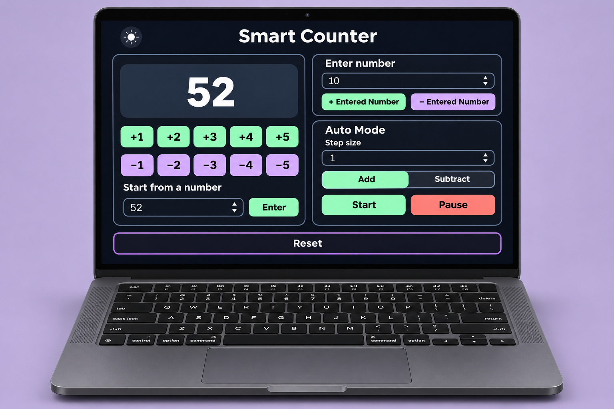
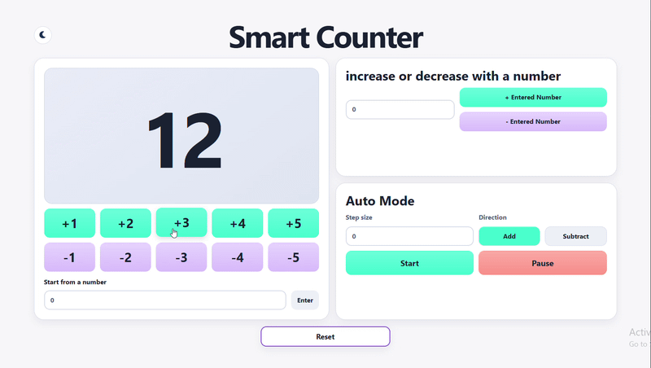
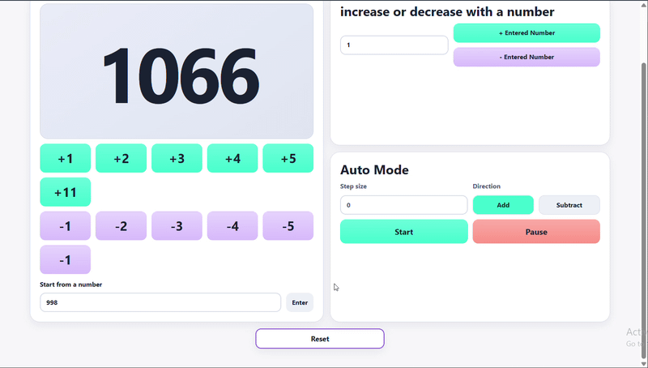
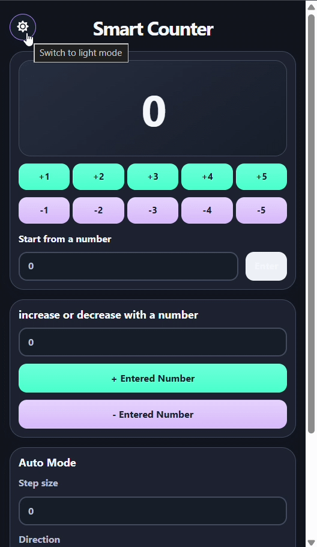

# Smart Counter 

## About

Smart Counter is a responsive counter that can start anywhere, count by custom steps, and run automatically. I built it to get comfortable with `addEventListener()` and arrow functions while building toward more advanced JavaScript. I started with a **+1** button. Somewhere along the way, it got a keyboard, a timer, and a night shift.

## Preview

*Design mockups showing the mobile and desktop layouts in both themes.*

## Installation & Usage

Clone or download the repository. Open the project folder in VS Code and launch `index.html` with **Live Server**. There are no project dependencies to install.

| Try this | What happens |
| --- | --- |
| Click a quick-action button | Add or subtract 1–5. |
| Press **1–5** on your keyboard | Add the corresponding number. Press **−** first to subtract it. |
| Use **Start from a number** | Type a value and press **Enter** or click the **Enter** button to set the total. |
| Use **+ Entered Number** or **− Entered Number** | Change the total by that amount and add a reusable quick button for that step. |
| Try **Auto Mode** | Pick a step size and direction. **Start** counts once per second, and **Pause** stops the timer. |
| Click the moon or sun | Switch between light and dark themes. |
| Hit **Reset** | Stop Auto Mode and return the count to zero. A fresh start, mathematically speaking. |

## Additional Info & Contributing

### JavaScript concepts I practiced

| Concept | How I used it |
| --- | --- |
| `addEventListener()` and arrow functions | Respond to clicks and key presses. |
| DOM selection and updates | Read input values, display the count with `textContent`, and create buttons with `createElement()`. |
| Keyboard events | Use `event.key` to read the key and `event.target` to avoid triggering shortcuts while someone is typing in a number field. |
| State, number conversion, and arrays | Track the count and the pending minus sign, convert input text with `Number()`, and use `includes()` to avoid duplicate custom buttons. |
| Timers | Use `setInterval()` and `clearInterval()` to start and pause Auto Mode. Keep the interval ID so repeated Start clicks don’t stack timers. |
| Theme switching | Use `classList.toggle()` to switch the theme and swap the moon and sun icons. |

### Credits

I wrote the HTML and JavaScript. ChatGPT provided the CSS styling.

### Contributing

Found a bug or have an idea? Open an issue and tell me what you tried and what you expected. For a code change, fork the repository and open a pull request with a short explanation.
